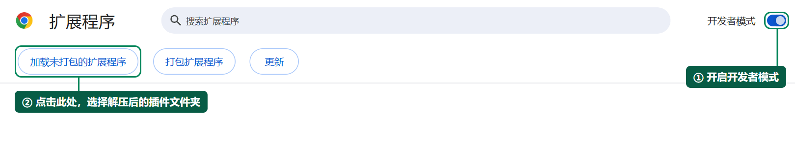
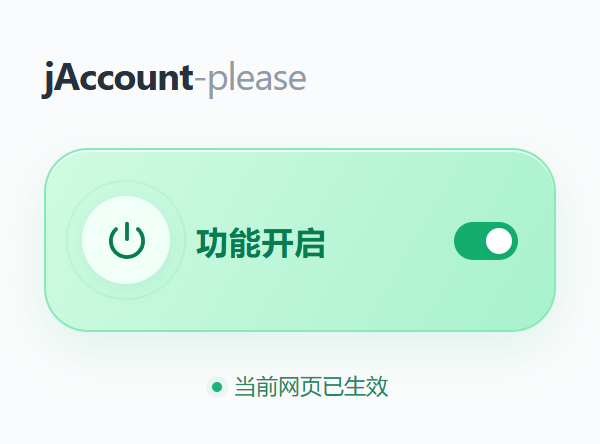

# jAccount-please

## 实现功能

保留学校相关页面的登录信息，避免关闭浏览器后需要重新登录的情况。支持 `sjtu.edu.cn` 及全部子域名。

## 实现原理

学校网站通过会话 Cookie 保存登录凭证。这类 Cookie 会在浏览器会话结束后被清除，因此重新打开浏览器时需要再次登录。

插件自动将学校网站的会话 Cookie 改为保存 30 天，并记录修改。关闭功能时，将记录中的 Cookie 一次性恢复为会话 Cookie，完成还原后清除对应记录。

## 使用方法

1. 从 [Releases](https://github.com/KiiiLin/jAccount-please/releases/latest) 下载 `jAccount-please-v1.2.0.zip`，解压并将 `jAccount-please` 文件夹放在固定位置。
2. Chrome 打开 `chrome://extensions`，Edge 打开 `edge://extensions`。
3. 开启“开发者模式”，点击加载本地扩展的按钮（Chrome 中为“加载未打包的扩展程序”），选择包含 `manifest.json` 的插件文件夹。

4. 点击浏览器工具栏中的插件图标，将“功能开启”切换为绿色。
5. 打开学校网页并正常登录。插件下方显示“当前网页已生效”即可。

再次点击按钮即可关闭功能，并执行一次 Cookie 还原。

更新已有版本时，将新文件覆盖到原插件目录，再到扩展管理页点击“重新加载”。
